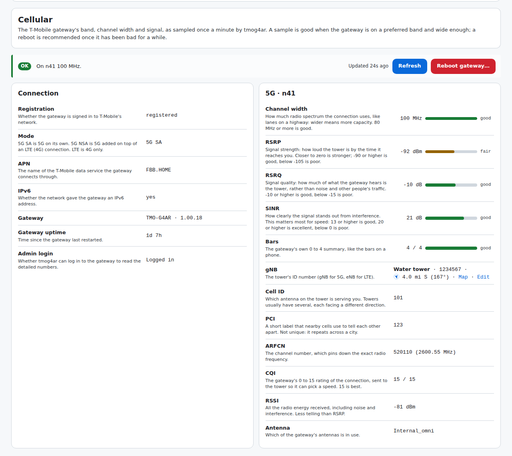
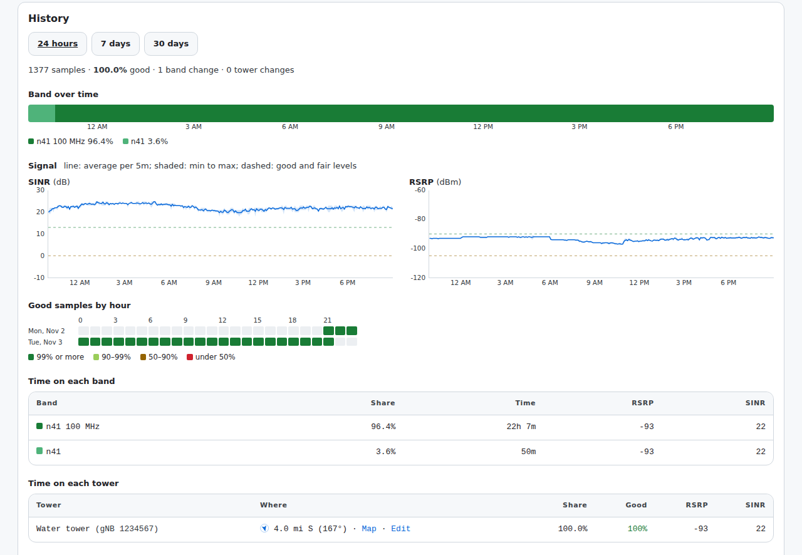
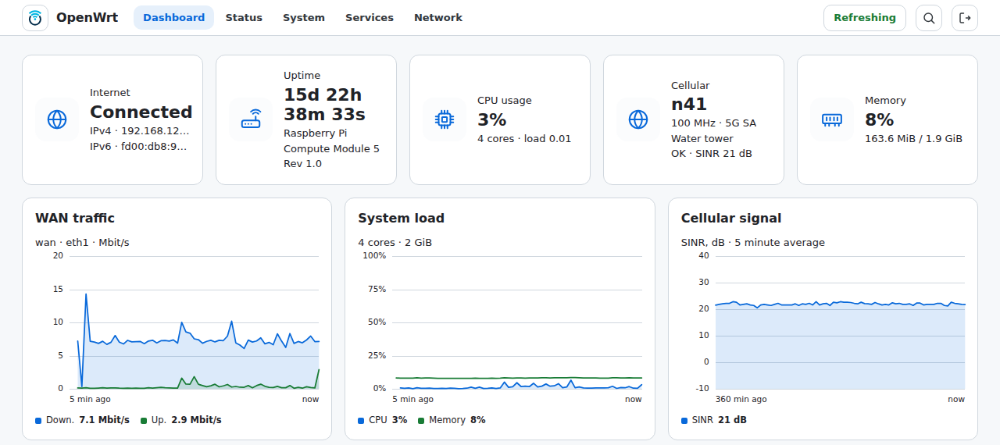

# tmog4ar

Status, history and "is it stuck?" checks for the T-Mobile Home Internet **TMO-G4AR** (Arcadyan) gateway, for an OpenWrt router sitting behind it. There's a LuCI app for the router's web interface and a command line tool underneath it.



## Why

My gateway occasionally gets "stuck" on n25 with a 20 MHz channel instead of n41 at 100 MHz, leaving about a third of the usual bandwidth until it's rebooted. Short drops to another band are normal handovers and fix themselves. tmog4ar logs a sample every minute so it can tell those two cases apart, and tells you when a reboot is worth it.

## What you get

- **Status → Cellular** in LuCI: the band, channel width and signal (RSRP, RSRQ, SINR, etc), each with a one-line explanation of what it means and what counts as good. Plus a health verdict, a refresh button and a reboot button that asks first.
- **History** for the last 24 hours, 7 days or 30 days: which band you were on over time, SINR and RSRP charts, a good-samples-by-hour heatmap, time on each band and tower, and every band / tower change.
- **Tower names, distance and direction.** Name the towers you connect to (it links to [CellMapper](https://www.cellmapper.net) to find them) and the page shows "Water tower · 4.0 mi S" with an arrow pointing at it, which helps when you're deciding which window to put the gateway in.
- A **card on Status → Overview** and two **dashboard widgets** (if you use luci-mod-dashboard).
- A **command line tool**, `tmog4ar`, with the same status and history in a terminal.





## What you need

- **OpenWrt 25.12 or newer.** The packages are `.apk` files, which is the package format from 25.12 on; 24.10 and older use opkg and I don't build for them. Any router model works (the packages are architecture-independent).
- The router's WAN port plugged into one of the gateway's LAN ports, so the router can reach the gateway at `192.168.12.1`. That's the normal setup. If your gateway uses a different address, you can change it in Settings.
- The gateway's **admin password** (the one for its web page at `http://192.168.12.1`). Without it you still get the band, signal and history, but not the channel width, PCI / channel / CQI, or the reboot button.

## Install

1. **Open a shell on the router.** From a terminal (on Windows, PowerShell has `ssh` built in), using your router's address and the root password you use for LuCI:

   ```sh
   ssh root@192.168.1.1
   ```

2. **Add my package repository and install.** Paste these three lines:

   ```sh
   uclient-fetch -O /etc/apk/keys/tmog4ar.pem https://dave-atx.github.io/g4arctrl/tmog4ar.pem
   echo https://dave-atx.github.io/g4arctrl/packages.adb >> /etc/apk/repositories.d/customfeeds.list
   apk update && apk add tmog4ar luci-app-tmog4ar
   ```

   The first line installs the key the packages are signed with (it should match [openwrt/tmog4ar.pem](openwrt/tmog4ar.pem)). The install pulls in `curl` and `jq` and starts the `tmog4ar` service, which takes a sample once a minute. On a router without LuCI, leave out `luci-app-tmog4ar`.

3. **Set the gateway's admin password.** In LuCI, go to **Status → Cellular → Settings**, enter it under Admin password, and click **Save & Apply**.

4. **Wait a minute** and reload Status → Cellular. History builds up from here: the first useful hour-by-hour picture takes a day or so.

### Updating

```sh
apk update && apk upgrade
```

Your settings and history are kept.

### Without adding the repository

Download the two `.apk` files from [Releases](https://github.com/dave-atx/g4arctrl/releases), copy them to the router, and:

```sh
apk add --allow-untrusted ./tmog4ar-*.apk ./luci-app-tmog4ar-*.apk
```

You won't get updates through `apk upgrade` this way.

### Uninstall

```sh
apk del luci-app-tmog4ar tmog4ar
```

History stays in `/root/.tmog4ar/` and settings in `/etc/config/tmog4ar` until you delete them.

## Using it

### The health verdict

A sample is **good** when the gateway is registered on a preferred band (n41 by default) and, if the width is known, at least 40 MHz wide. The page shows:

- **OK** when the latest sample is good.
- **Degraded** when it isn't, but not for long. Short drops are normal handovers.
- **Reboot recommended** once samples have been bad for 30 minutes straight and a good one was seen in the past week. The week rule keeps it from recommending reboots when the n41 site itself is down.
- **Unreachable** when the gateway doesn't answer.

The preferred bands, minimum width and 30 minutes are all in Settings → Health. tmog4ar never reboots the gateway by itself; the reboot button asks first.

### Naming towers

Next to the tower number (gNB) on Status → Cellular:

1. **Find on CellMapper** opens CellMapper's map around your gateway. Towers are labelled with their numbers; click the one that matches.
2. **Name it…**: type a name and paste the CellMapper page's link into Location (after you click a tower, the map is centred on it). An Apple or Google Maps link, or plain `latitude, longitude`, works too.

Towers you've used before can be named from History → Time on each tower. Names live in `/etc/config/tmog4ar` on the router, nothing is looked up online, and your position only leaves the router if you click one of the map links.

### Command line

```
tmog4ar status [--json]      band, channel width, signal quality and health (default)
tmog4ar watch [-i SECS]      live view, refreshed every 15s by default
tmog4ar health               is it stuck? exit 0 ok, 2 degraded, 3 reboot recommended, 1 unreachable
tmog4ar history [-s 7d]      time per band and tower, quality per hour / day, band and tower changes
                             (--json for the numbers behind the LuCI charts)
tmog4ar reboot [--force]     reboot the gateway
tmog4ar raw [gateway|cell]   raw JSON from the gateway
```

```
$ tmog4ar status
TMO-G4AR  fw 1.00.18  ·  up 4h 21m  ·  2026-11-02 17:55:51
● registered  ·  5G SA  ·  APN FBB.HOME  ·  IPv6 yes

5G     n41
  Width    100 MHz ██████████  good
  RSRP     -93 dBm █████░░░░░  fair
  RSRQ     -10 dB  █████░░░░░  good
  SINR      22 dB  ███████░░░  good
  Bars     4.0 /4  ██████████  good
  Tower  Water tower · 4.0 mi ↓ S (167°)
  gNB 1234567 · CID 101 · PCI 500 · ARFCN 520110 · CQI 12 · RSSI -82 · Internal_omni

Health  OK  on n41 100 MHz
```

`tmog4ar health` exits 3 when a reboot is recommended, so you can build your own alerting or automation around it. `tmog4ar help` lists every command and setting.

## FAQ / troubleshooting

**Channel width says "n/a".** The admin password isn't set, or it's wrong. The Admin login row on Status → Cellular says which.

**"Admin login failed".** Check the password in Settings. After a failed login tmog4ar waits 15 minutes before trying that same password again, so it can't get the gateway to lock the account. Saving a different password tries it right away.

**"No sample yet" or the history is empty.** The service samples once a minute. Check it's running under System → Startup (`tmog4ar`), or from a shell: `/etc/init.d/tmog4ar status`.

**Is this hard on the gateway?** Each sample is one or two small requests a minute. The LuCI pages read the router's copy of the latest sample rather than asking the gateway, however many browsers have them open; Refresh asks the gateway only if that copy is more than 15 seconds old.

**What about my flash / SD card?** Samples wait in RAM and go to flash in one write an hour, one file per day, about 3 MB a month. Old days are deleted whole, so nothing on flash is rewritten. A power cut can lose up to an hour of history (Settings → History can change that).

**A tower number CellMapper has never heard of.** The gateway sometimes reports the tower number with one bit missing for a few minutes. History ignores those (same cell, same channel, number off by one bit); if you see another odd one, CellMapper not knowing it is a good hint it's bogus.

**Does anything leave my network?** No. tmog4ar talks to the gateway and nothing else. The only outside links are CellMapper and Apple Maps, and only when you click them.

## Raspberry Pi 5 images

Each release also has OpenWrt 25.12 images for the Pi 5 (ext4 or squashfs, factory or sysupgrade) built with the [Image Builder](https://openwrt.org/docs/guide-user/additional-software/imagebuilder), in two flavours:

- `tmog4ar`: tmog4ar, the LuCI app, the packages in [openwrt/image/packages.txt](openwrt/image/packages.txt) and the repository above.
- `tmog4ar-cake-adapt`: the same plus [cake-adapt](https://github.com/huydoan94/cake-adapt) and its LuCI app, an adaptive SQM shaper for connections whose speed changes, like 5G home internet. cake-adapt isn't in the OpenWrt feeds, so `apk upgrade` won't update it; the next image will.

They carry no configuration, so after flashing set the gateway password as in step 3. A sysupgrade keeps `/etc/config/tmog4ar` and the history. The release notes list the packages that changed since the previous release, and each image's `.manifest` lists all of them.

The online firmware builders (firmware selector, `owut`, Attended Sysupgrade) only know about official packages, so their images can't include tmog4ar or cake-adapt. Reinstall them after upgrading with those, or upgrade with these images instead.

## Development

The CLI is a single POSIX shell script (busybox ash, also dash / bash) that needs `curl` and `jq` and reads its settings from UCI. The LuCI app is in [openwrt/luci-app-tmog4ar](openwrt/luci-app-tmog4ar). [AGENTS.md](AGENTS.md) has the conventions and the traps.

### Without the package

```sh
apk add curl jq
cp tmog4ar /usr/bin/ && cp tmog4ar.init /etc/init.d/tmog4ar
cp tmog4ar.config /etc/config/tmog4ar && chmod 600 /etc/config/tmog4ar
/etc/init.d/tmog4ar enable && /etc/init.d/tmog4ar start
```

### Building the packages

With the [OpenWrt SDK](https://openwrt.org/docs/guide-developer/using_the_sdk) for 25.12 (any target). The LuCI app builds with `luci.mk`, so keep the default feeds, which include luci:

```sh
echo "src-link tmog4ar /path/to/g4arctrl/openwrt" >> feeds.conf
./scripts/feeds update -a && ./scripts/feeds install tmog4ar luci-app-tmog4ar
make defconfig && make package/tmog4ar/compile package/luci-app-tmog4ar/compile
```

CI ([.github/workflows/build.yml](.github/workflows/build.yml)) builds both packages and the Pi 5 images on every push. To release, bump `VERSION` in `tmog4ar` and `PKG_VERSION` in `openwrt/tmog4ar/Makefile` and `openwrt/luci-app-tmog4ar/Makefile`, then push a `vX.Y.Z` tag. That creates the GitHub release and updates the repository on GitHub Pages, signed with the key in the `APK_PRIVATE_KEY` secret.

### Changing the images

- [openwrt/image/packages.txt](openwrt/image/packages.txt): packages in every image.
- [openwrt/image/variants/](openwrt/image/variants): one file per image, with its own packages, plus `apk <url> <sha256>` lines for packages that aren't in any feed. A new file is a new image.
- [openwrt/image/minimum-versions.txt](openwrt/image/minimum-versions.txt): the build fails if an image has an older version of a package listed here. Use it when a fix is merged in openwrt/packages but the release feed hasn't been rebuilt yet.

To rebuild only the images, without a new tmog4ar version (for example when an OpenWrt package gets a security fix), push a `vX.Y.Z-rN` tag on the current version: `v0.2.0-r1`, `v0.2.0-r2`. That makes a release with the images and leaves the repository on Pages alone.

## Credits

The gateway API details come from [zacharee/HINTControl](https://github.com/zacharee/HINTControl), which did the reverse engineering.

This isn't affiliated with or endorsed by T-Mobile. Licensed under Apache 2.0 ([LICENSE](LICENSE)).
